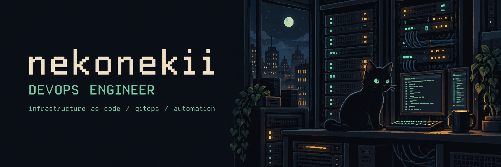

<p align="center">
  
</p>

<p align="center">
  <a href="#about">About</a> &nbsp; / &nbsp;
  <a href="#toolbox">Toolbox</a> &nbsp; / &nbsp;
  <a href="#selected-work">Selected work</a>
</p>

### About

I'm **Vladislav**, a DevOps engineer working with declarative infrastructure, Kubernetes and GitOps. My repositories cover cluster bootstrapping, application delivery and infrastructure automation.

```yaml
nekonekii:
  focus:       infrastructure as code
  delivery:    Git → Argo CD → Kubernetes
  approach:    version it, automate it, make it repeatable
  off_duty:    Neovim configs & custom keyboards
```

### Toolbox

| Layer | Tools in my repositories |
| :--- | :--- |
| Infrastructure | `Terraform` · `Terramate` · `AWS EKS` · `IAM` |
| Platform & delivery | `Kubernetes` · `Argo CD` · `Kustomize` · `Docker` |
| Configuration & secrets | `Ansible` · `Vault` · `External Secrets` |
| Traffic | `Traefik` · `Cloudflare Tunnel` |

### Selected work

<table>
<tr>
<td width="50%" valign="top">

#### [GitOps starter](https://github.com/nekonekii/gitops-template-argocd)

A single-cluster Argo CD template with an app-of-apps bootstrap and ApplicationSets for adding workloads.

`Kubernetes` `Argo CD` `GitOps`

</td>
<td width="50%" valign="top">

#### [Agent delivery](https://github.com/nekonekii/hermes-agent-gitops)

Declarative deployment for Hermes Agent: Kustomize overlays, automated sync and runtime secrets from Vault.

`Kustomize` `External Secrets` `Traefik`

</td>
</tr>
<tr>
<td width="50%" valign="top">

#### [Infrastructure stacks](https://github.com/nekonekii/infra)

Terraform modules and Terramate stack definitions for organization, EKS and IAM infrastructure.

`Terraform` `Terramate` `AWS`

</td>
<td width="50%" valign="top">

#### [Editor workshop](https://github.com/nekonekii/lazyvim-config)

My LazyVim configuration. A small corner of this profile dedicated to the tools I work in.

`Neovim` `LazyVim` `Lua`

</td>
</tr>
</table>

<p align="center"><sub>Declarative infrastructure. Repeatable deployments. A cat near the keyboard.</sub></p>
